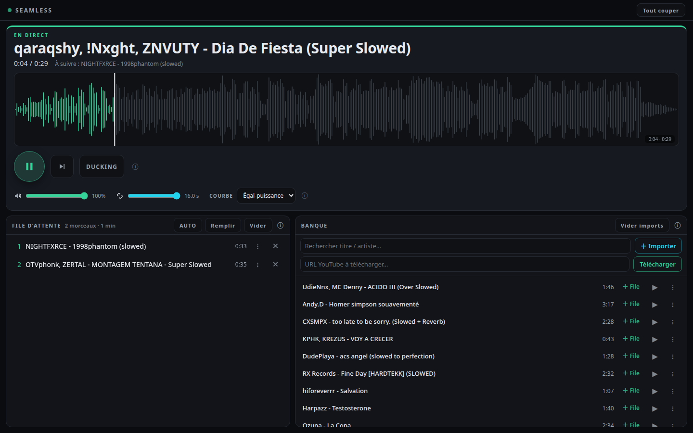
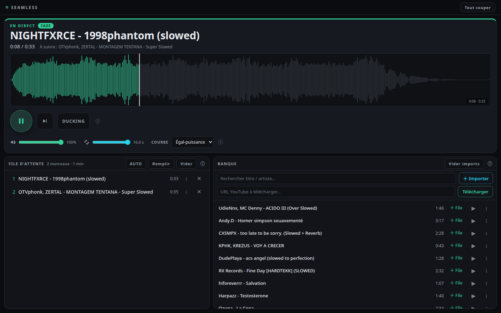
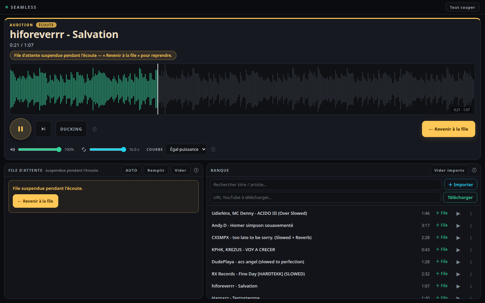

# Seamless

DJ de soirée autonome : il enchaîne les morceaux sans aucun silence, gère la file en direct et baisse le son pour les prises de parole.
Local-first : tout tourne sur la machine, aucune donnée ne sort — hors téléchargements YouTube explicitement demandés.





**Sommaire** : [Démarrage rapide](#démarrage-rapide) · [Fonctionnalités](#fonctionnalités) · [Prérequis](#prérequis) · [Installation](#installation-et-lancement) · [Dossier musique](#dossier-musique) · [Utilisation](#utilisation) · [Désinstallation](#désinstallation) · [Architecture](#architecture) · [Tests](#tests) · [Dépannage](#dépannage)

## Démarrage rapide

1. **Récupérer le projet** : bouton **Code → Download ZIP** sur GitHub puis extraire l'archive, ou cloner le dépôt (`git clone`).
2. **Installer** (une seule fois) :
   - Linux / macOS : `./setup.sh`
   - Windows : `powershell -ExecutionPolicy Bypass -File setup.ps1`
3. **Lancer** :
   - Linux / macOS : `./lancer.sh`
   - Windows : `.\lancer.ps1` — ou double-clic sur `lancer.vbs` (aucune console).
4. L'UI s'ouvre sur <http://127.0.0.1:8092/>. Ajoutez des morceaux (`＋ Importer`, glisser-déposer, ou clic dans la banque), puis `P` pour jouer.

> Scripts en `Permission denied` après un ZIP (Linux/macOS) : `chmod +x *.sh` — GitHub ne conserve pas le bit exécutable.
>
> Arrêt : `./stop.sh` (Linux/macOS), `.\stop.ps1` (Windows), ou bouton **Tout couper** dans l'UI.

## Fonctionnalités

- **File d'attente live** : ajout, retrait, réordonnancement, « placer en piste suivante ».
- **Auto-file** : anti-doublon, espacement d'un même artiste ≥ 3 morceaux, évite l'historique récent (relâché du plus ancien d'abord), variété des dossiers ; re-remplissage automatique sous un seuil réglable.
- **Crossfade 2 à 16 s** avec 4 courbes : linéaire (`out+in=1`), égal-puissance (`out²+in²=1`), douce (smoothstep), coupe (gains linéaires, ≤ 0,35 s).
- **Ducking** (`Espace`) : baisse du master à 25 % avec une rampe de 100 ms.
- **Zéro silence** : cues détectés à −35 dBFS, fondu d'entrée/sortie de 220 ms, jamais de coupure sèche.
- **Skip en fondu** : `N` (ou le bouton suivant) enchaîne avec un fondu de 0,6 à 2 s, proportionnel au crossfade réglé — jamais de coupure sèche ; l'audition (`double-clic`) utilise le même fondu.
- **Audition** : écoute un morceau de la banque sans casser la file ; « Revenir à la file » (ou `Échap`) restaure la file et reprend la lecture si elle jouait avant l'écoute.
- **Import local** : bouton `＋ Importer` ou glisser-déposer (mp3, wav, flac, aac, m4a, ogg ; 200 Mo max par fichier) ; un fichier déjà présent à l'identique (même contenu) est ignoré, le toast indique les deux compteurs.
- **Suppression d'un import** : menu `⋮` d'une rangée de la banque → « Supprimer l'import » (confirmation en deux clics). Le fichier est effacé de `downloads/` et retiré de la banque, de la file et de l'historique. La musique perso n'est jamais supprimable.
- **Téléchargement YouTube** via yt-dlp (2 jobs max), arrivée directe dans la banque.
- **Restauration après crash** : proposition de reprendre la soirée au même endroit (piste, position, file, réglages).
- **UI hors-ligne** : HTML/CSS/JS vanilla, aucun CDN, aucune ressource distante.
- **Raccourcis clavier** pour tout piloter sans la souris.

## Prérequis

- Python **3.10+** (3.12 recommandé).
- `ffmpeg` **et** `ffprobe` dans le `PATH`.
- Linux / macOS : `curl` (contrôle de démarrage de `lancer.sh`).
- Linux : ALSA (`libasound2`, ou `libasound2t64` sur Ubuntu 24.04+), lecture native via ctypes.
- Windows / macOS : `sounddevice`, installé automatiquement par `requirements.txt` via marqueur de plateforme.

## Installation et lancement

Toutes les commandes se lancent **depuis le dossier du projet** (celui qui contient `setup.sh` / `setup.ps1`).
L'UI s'ouvre ensuite sur <http://127.0.0.1:8092/>.

Détail par OS, backends audio et dépannage : [docs/PORTABILITE.md](docs/PORTABILITE.md).

### Linux

```sh
chmod +x *.sh       # seulement après un téléchargement ZIP
./setup.sh          # venv + dépendances (une fois)
./lancer.sh         # démarre en arrière-plan et ouvre l'UI
./stop.sh           # arrêt propre
./lancer.sh --fg    # premier plan (debug)
```

### Windows (PowerShell)

```powershell
powershell -ExecutionPolicy Bypass -File setup.ps1
.\lancer.ps1
.\stop.ps1
```

Si PowerShell refuse de lancer le script : `powershell -ExecutionPolicy Bypass -File lancer.ps1` (ou double-clic sur `lancer.vbs`, qui ne montre aucune fenêtre).

### macOS

```sh
./setup.sh
./lancer.sh
./stop.sh
```

Backend audio CoreAudio via `sounddevice`.

### FFmpeg

```sh
sudo apt install ffmpeg      # Debian / Ubuntu
winget install Gyan.FFmpeg   # Windows
brew install ffmpeg          # macOS
```

### Installer un raccourci

```sh
./installer.sh                                          # Linux : entrée de menu + raccourci Bureau
powershell -ExecutionPolicy Bypass -File installer.ps1   # Windows : Bureau + menu Démarrer
```

Double-clic sur **Seamless** : serveur en arrière-plan, UI ouverte, sans console sous Windows.

## Dossier musique

Ordre de résolution :

1. `--music-dir` (répétable) ;
2. `SEAMLESS_MUSIC_DIR` — dossiers séparés par `os.pathsep` (`:` sous Linux/macOS, `;` sous Windows) ;
3. `~/Music` et `./music` (s'ils existent) ;
4. `downloads/` est toujours inclus.

Pour fixer le dossier sans argument, créer `data/local.env` (dossier ignoré par git ; le fichier n'est pas créé automatiquement). Sous Linux/macOS, `lancer.sh` le charge s'il existe :

```sh
SEAMLESS_MUSIC_DIR=/chemin/vers/ma/musique
```

Sous Windows : définir `$env:SEAMLESS_MUSIC_DIR = "D:\Ma musique"` dans la session PowerShell avant `.\lancer.ps1`.

Les dossiers de musique sont ouverts en lecture seule : Seamless n'y écrit ni n'y supprime jamais rien.

Les dossiers `data/` et `downloads/` sont créés au premier lancement et ne sont jamais versionnés.

## Utilisation

| Touche | Action |
| --- | --- |
| `N` | Morceau suivant (transition courte) |
| `P` | Lecture / pause |
| `F` | Recherche dans la banque |
| `A` | Auto-file : complète la file |
| `+` / `-` | Volume ±5 % |
| `Espace` | Ducking (baisse le son) |
| `Échap` | Quitter l'audition et revenir à la file |

Souris :

- **Clic** sur un morceau de la banque : l'insère après le titre courant.
- **Double-clic** : écoute le morceau (audition) ; `Échap` restaure la file.
- **Glisser-déposer** : banque → file, réordonner la file, fichiers de l'OS → banque.
- **Menu `⋮`** (ou clic droit) : placer en piste suivante, ajouter à la fin, écouter, retirer de la file ; sur un import, **supprimer l'import** (deux clics de confirmation).

Boutons de l'interface :

- **Remplir** : ajoute 10 morceaux à la file (anti-doublon, artistes espacés).
- **Vider** : vide la file d'attente (confirmation en deux clics).
- **Vider imports** : supprime tous les fichiers de `downloads/` (imports et téléchargements) ; pour un seul morceau, menu `⋮` → « Supprimer l'import ». Le dossier musique personnel n'est jamais modifié.
- **Tout couper** : arrête Seamless, serveur compris (confirmation en deux clics).

## Désinstallation

1. **Arrêter le serveur** : `./stop.sh` (Linux/macOS), `.\stop.ps1` (Windows) — ou **Tout couper** dans l'UI.
2. **Supprimer les raccourcis** (uniquement si `installer.sh` / `installer.ps1` a été utilisé) :

   Linux :

   ```sh
   rm -f ~/.local/share/applications/seamless.desktop ~/Bureau/seamless.desktop ~/Desktop/seamless.desktop
   update-desktop-database ~/.local/share/applications 2>/dev/null
   ```

   Windows (PowerShell) :

   ```powershell
   Remove-Item "$([Environment]::GetFolderPath('Desktop'))\Seamless.lnk" -ErrorAction SilentlyContinue
   Remove-Item "$([Environment]::GetFolderPath('Programs'))\Seamless.lnk" -ErrorAction SilentlyContinue
   ```

3. **Supprimer le dossier du projet** : il contient tout le reste (code, `.venv/`, `data/`, `downloads/`).

Ce que contiennent les dossiers créés au runtime :

| Dossier | Contenu | Conséquence si supprimé |
| --- | --- | --- |
| `data/` | file, historique, cues analysés, réglages, logs | perte de la reprise de session et des cues (réanalysés au besoin) |
| `downloads/` | morceaux téléchargés (yt-dlp) et importés | perte de ces fichiers ; le dossier musique personnel n'est **jamais** touché |
| `.venv/` | environnement Python | recréé par `setup.sh` / `setup.ps1` |

Pour ne garder que le code : supprimer `data/`, `downloads/` et `.venv/` sans effacer le dossier du projet.

## Architecture

```
Seamless/
├── app/
│   ├── engine.py        # moteur : mixage, crossfade, cues, ducking
│   ├── output_alsa.py   # sortie ALSA native (Linux, ctypes)
│   ├── output_sd.py     # sortie sounddevice (Windows / macOS)
│   ├── server.py        # FastAPI : API JSON, SSE, static
│   ├── state.py         # persistance de l'état (écriture atomique)
│   ├── queue_rules.py   # règles de la file auto (pures, sans I/O)
│   ├── ytdl.py          # téléchargement YouTube (yt-dlp, 2 jobs max)
│   └── static/          # UI vanilla : index.html, app.js, style.css
├── tests/               # pytest headless (sortie audio factice)
├── data/                # runtime : état, cues, pid, logs (non versionné)
├── downloads/           # musiques téléchargées / importées (non versionné)
└── .venv/               # environnement Python créé par setup (non versionné)
```

Versionnés : `app/`, `tests/`, `docs/`, les scripts `setup`/`lancer`/`stop`/`installer`, `requirements.txt`, `README.md`, `LICENSE` et `.github/`.
`data/`, `downloads/`, `.venv/`, `music/` et `data/local.env` ne le sont jamais (voir `.gitignore`).

Un seul thread mixeur possède le rendu ; l'horloge est l'écriture bloquante vers la sortie.
Chaque piste est un pipe `ffmpeg` en float32 stéréo au taux du device, ouverte juste avant son fade.
Les cues (−35 dBFS) coupent les silences : la transition se termine pile à la fin du signal.

## Tests

```sh
.venv/bin/python -m pytest tests/ -q      # Linux / macOS
.venv\Scripts\python -m pytest tests\ -q  # Windows
```

90 tests headless : aucun device audio requis, `ffmpeg`/`ffprobe` requis (WAV synthétiques).
La CI GitHub Actions couvre Linux, Windows et macOS (`.github/workflows/tests.yml`) ;
les 2 tests du backend ALSA (`libasound.so.2` chargée à l'import du module) ne tournent que sous Linux.

## Dépannage

**Pas de son** — vérifier la sortie par défaut ALSA/PipeWire (`wpctl status`, `aplay -l`) et le volume système. Le serveur doit tourner dans la même session que la carte.

**ffmpeg introuvable** — installer ffmpeg (voir plus haut), puis vérifier `ffmpeg -version` et `ffprobe -version` dans le `PATH` du shell qui lance le serveur.

**Port 8092 occupé** — `ss -ltnp | grep 8092` (ou `lsof -i :8092`), arrêter l'ancien process (`./stop.sh`), puis changer de port : `./lancer.sh 8093` (Linux/macOS), `.\lancer.ps1 -Port 8093` (Windows). Une instance déjà lancée garde son port : arrêtez-la avant d'en démarrer une autre sur un port différent.

**sounddevice absent (Windows / macOS)** — réinstaller les dépendances dans le venv : `.venv\Scripts\python.exe -m pip install -r requirements.txt` (Windows) ou `.venv/bin/python -m pip install -r requirements.txt` (macOS).

## Vie privée

100 % local : aucune télémétrie, aucun compte, aucune requête sortante — sauf les téléchargements YouTube demandés (yt-dlp).
L'état de session, l'historique et les fichiers importés restent dans `data/` et `downloads/`, ignorés par git.

## Licence

MIT — voir [`LICENSE`](LICENSE).
